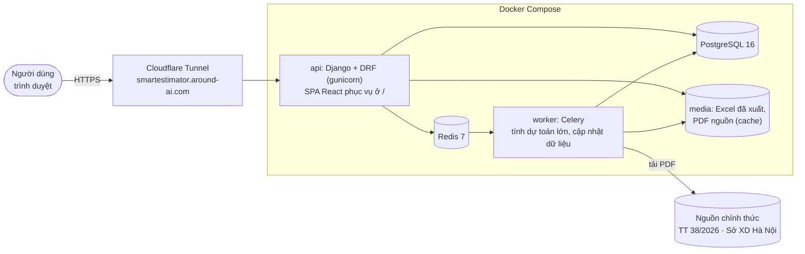
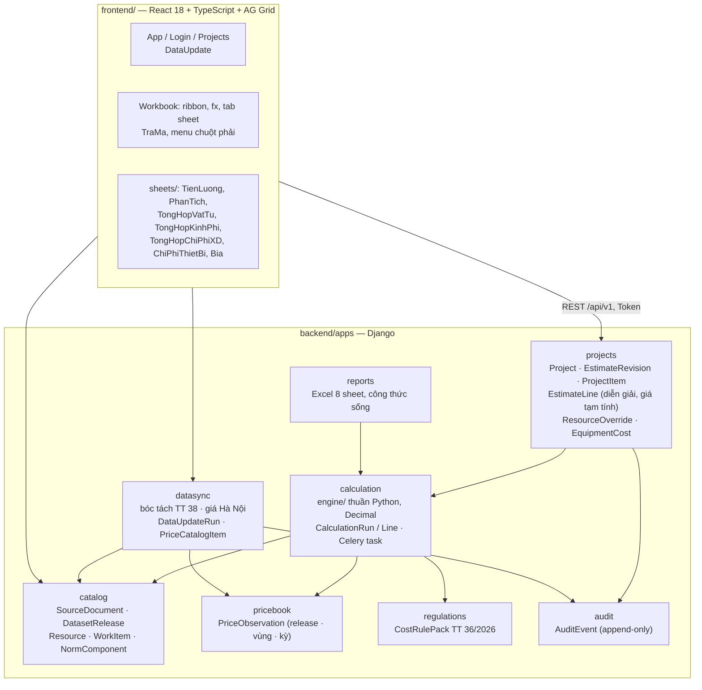
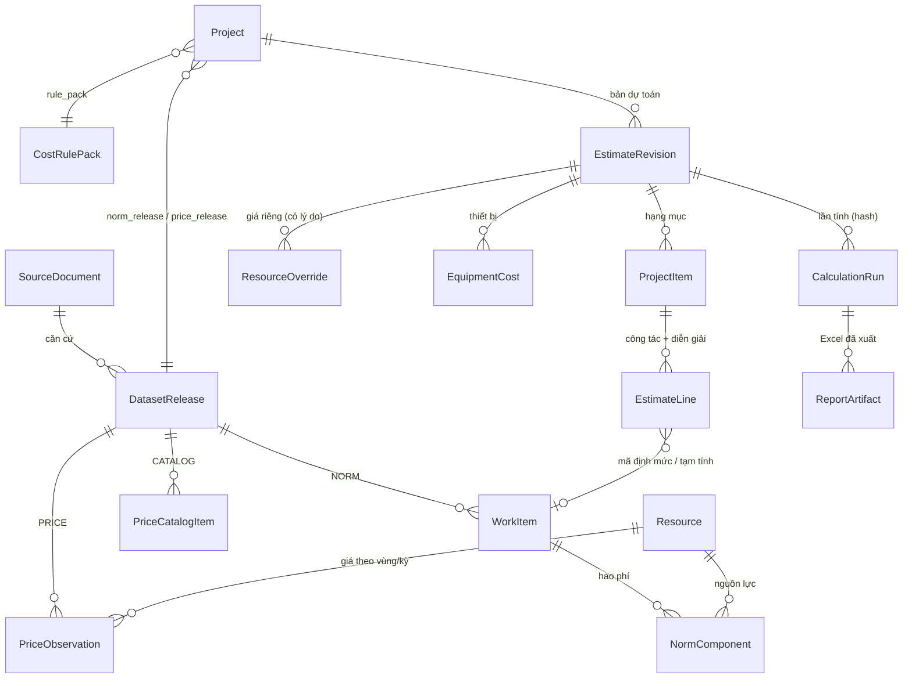
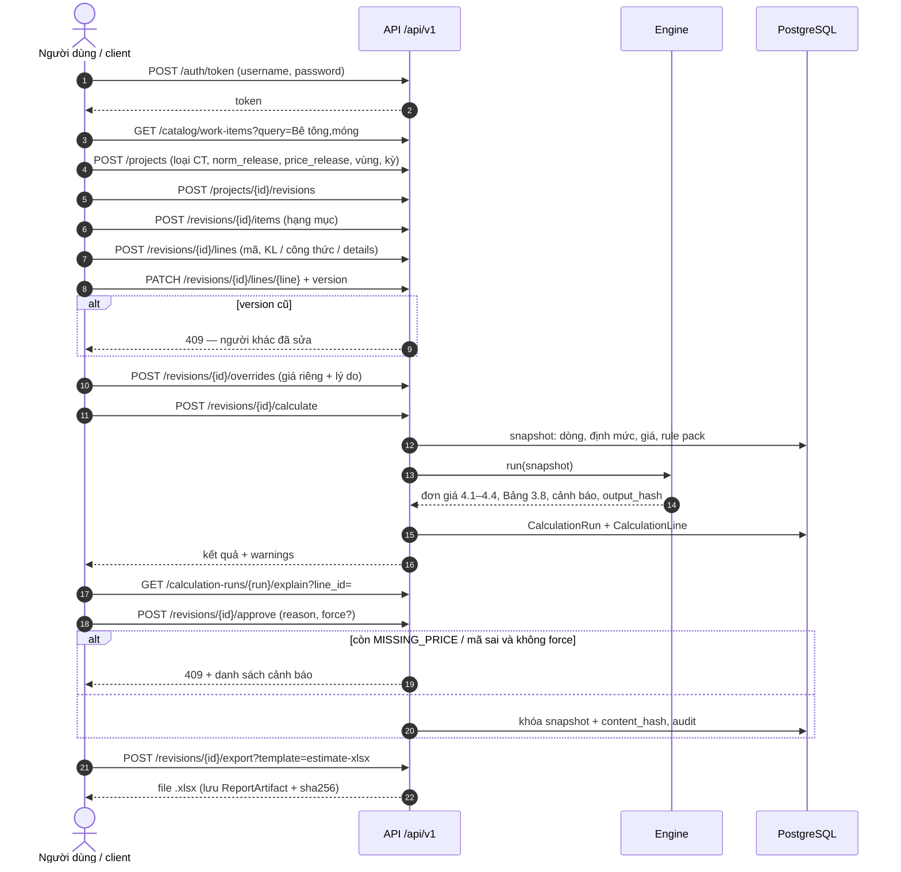
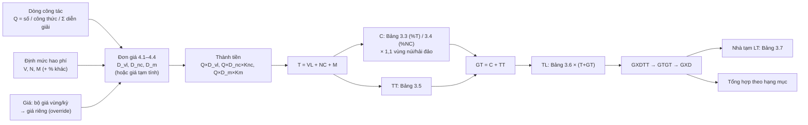
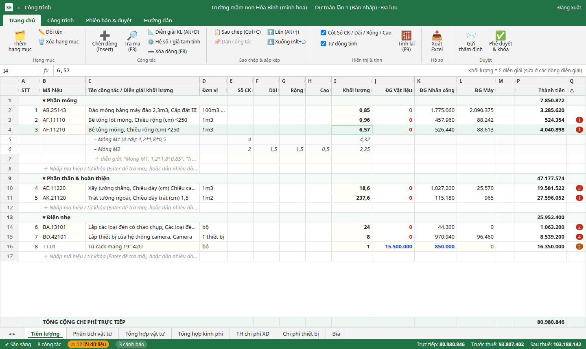
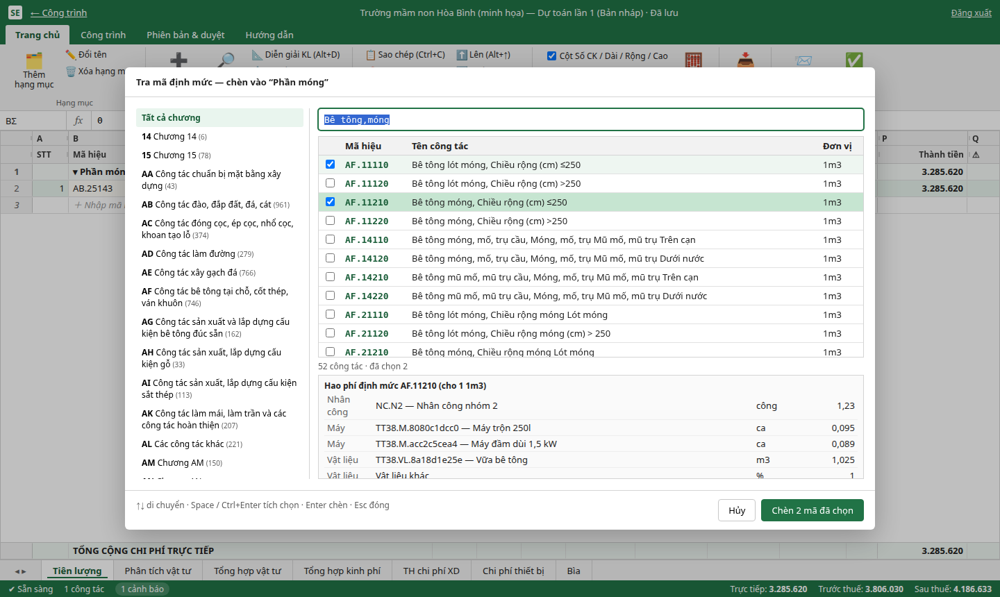
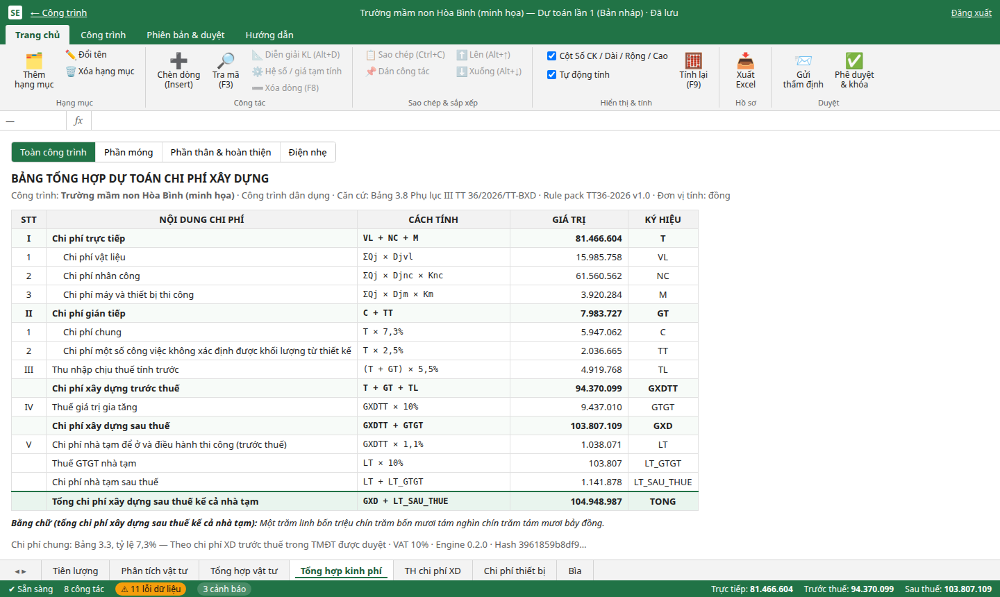
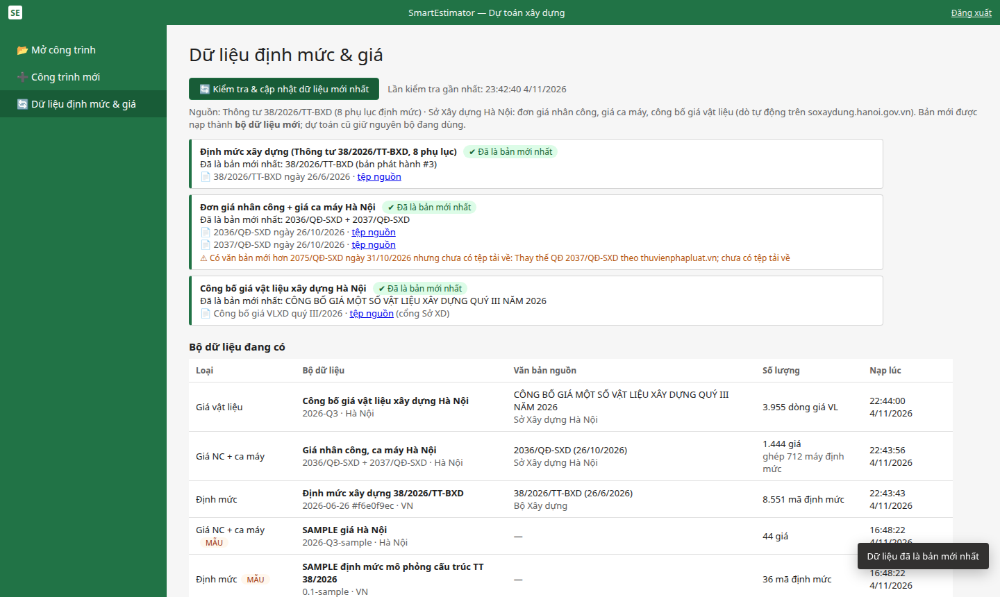

# SmartEstimator

Webapp nội bộ lập **dự toán xây dựng theo định mức và đơn giá Việt Nam**:
- giao diện kiểu Excel, thao tác theo cách của Dự toán G8;
- engine tính theo TT 36/2026;
- dữ liệu thật: định mức TT 38/2026 và giá Hà Nội, có nút cập nhật;
- xuất Excel có công thức.
Thiết kế: [`g8-enterprise-webapp-architecture.md`](g8-enterprise-webapp-architecture.md). Rule pack: [`docs/rule-pack-tt36-2026.md`](docs/rule-pack-tt36-2026.md). Mô hình dữ liệu: [`docs/data-dictionary.md`](docs/data-dictionary.md).

> ⚠ `backend/fixtures/sample_catalog.json` là dữ liệu **MẪU**, chỉ dùng để chạy thử và cho test. Dữ liệu thật (TT 38/2026, giá Hà Nội) được nạp bằng nút *Cập nhật dữ liệu* hoặc lệnh `manage.py update_data`; xem mục bên dưới. Rule pack TT 36/2026 trích từ PDF phụ lục chính thức nhưng **chưa được kỹ sư dự toán ký duyệt** (engine luôn phát cảnh báo `RULE_PACK_NOT_APPROVED`).

## Đường dẫn nhanh

| Trang | Link |
|---|---|
| Danh sách công trình | https://smartestimator.around-ai.com/#/ |
| Tạo công trình mới | https://smartestimator.around-ai.com/#/moi |
| **Dữ liệu định mức & giá** (kiểm tra / cập nhật) | https://smartestimator.around-ai.com/#/du-lieu |
| Bảng dự toán của công trình | `https://smartestimator.around-ai.com/#/p/<id>` (thêm `/r/<id>` để mở một bản dự toán) |
| Admin Django | https://smartestimator.around-ai.com/admin |

Tài liệu liên quan:
- **`docs/huong-dan-su-dung.md`: hướng dẫn sử dụng từng bước, có ảnh.**
- `docs/g8-ui-analysis.md`: phân tích giao diện Dự toán G8 và so với SmartEstimator.
- `docs/rule-pack-tt36-2026.md`: bảng tỷ lệ chi phí theo TT 36/2026.
- `docs/data-dictionary.md`: từ điển dữ liệu.
- `PLAN.md`: các việc còn lại.

## Chạy (Ubuntu + Docker Compose)

```bash
cp .env.example .env            # sửa secret/port nếu cần (mặc định API :8000, Postgres :5434, Redis :6380 trên 127.0.0.1)
make build                      # build image backend
make up                         # db + redis + api (tự migrate) + worker
make seed                       # nạp rule pack TT 36/2026 + catalog MẪU + user demo (in ra API token)
make test                       # pytest toàn bộ (engine, fixtures, API end-to-end)
```

Admin: http://127.0.0.1:8000/admin hoặc https://smartestimator.around-ai.com/admin (user `demo`; mật khẩu seed mặc định `demo12345` — **đổi ngay** nếu đã công khai: `docker compose exec api python manage.py changepassword demo`). API prefix: `http://127.0.0.1:8000/api/v1`.

## Giao diện người dùng (kiểu Excel)

Mở https://smartestimator.around-ai.com (hoặc http://127.0.0.1:8000) → đăng nhập → **Công trình mới** / mở công trình.

- **Ribbon** (Trang chủ · Công trình · Phiên bản & duyệt · Hướng dẫn), **thanh công thức fx** + name box, **tab sheet** ở đáy, **thanh trạng thái** hiện T / trước thuế / sau thuế / thiết bị và số cảnh báo.
- Sheet **Tiên lượng** (thao tác theo kiểu Dự toán G8 — xem `docs/g8-ui-analysis.md`):
  - Dòng "＋" cuối hạng mục: gõ **mã đủ** (`AF.12111`) → Enter nhận ngay; gõ **đầu mã** (`AE`) hoặc **từ khóa** (`Trát,75`) → Enter mở **Tra mã**: lọc theo chương, xem hao phí, **tích chọn nhiều mã** rồi chèn một lần. **F3** mở Tra mã bất kỳ lúc nào.
  - **Diễn giải khối lượng** nhiều dòng dưới mỗi công tác (Alt+D hoặc chuột phải): `Móng M1: 1,2*1,8*0,85` (chú thích + công thức), `Trục A:` (ghi chú), hoặc nhập cột **Số CK × Dài × Rộng × Cao**. Khối lượng công tác = tổng diễn giải. Ẩn/hiện cột kích thước trên ribbon.
  - Khối lượng không có diễn giải: số `15,5` hoặc `=2*(3,5+4,2)*0,22`.
  - **Mã tạm tính** (không có trong định mức): gõ thẳng đơn giá vào ô ĐG Vật liệu / Nhân công / Máy (hoặc "Hệ số / giá tạm tính"); không còn bị tính là lỗi chặn duyệt.
  - **Chuột phải**: chèn lên trên, tra mã, thêm diễn giải, hệ số Knc/Km, sao chép / dán công tác (kèm diễn giải), đưa lên / xuống, xóa, thêm / đổi tên hạng mục.
  - Phím tắt: **Insert** chèn dòng lên trên · **F3** tra mã · **F8** xóa dòng · **Alt+↑/↓** di chuyển · **Alt+D** diễn giải · **Ctrl+C / Ctrl+V** sao chép công tác · **F9** tính lại · Ctrl/Shift+click chọn nhiều dòng.
  - **Dán từ Excel**: copy các cột Mã hiệu / Tên / Đơn vị / Khối lượng → Ctrl+V.
- Sheet **Phân tích vật tư**, **Tổng hợp vật tư** (sửa ô Đơn giá → giá riêng dự án, bắt buộc ghi lý do), **Tổng hợp kinh phí** (Bảng 3.8; chọn **toàn công trình hoặc từng hạng mục**), **TH chi phí XD** (theo hạng mục + nhà tạm + thiết bị, **bằng chữ**), **Chi phí thiết bị** (giá trước thuế, thuế suất, sau thuế), **Bìa** (in Ctrl+P).
- Ribbon **Công trình** → **Thông tin công trình**: chủ đầu tư, đơn vị lập, người lập / kiểm tra, loại công trình, thuế, đổi **bộ giá / địa phương / kỳ giá** (tính lại ngay).
- **Xuất Excel** (8 sheet: Bìa, Tham số, Tiên lượng có dòng diễn giải và `=ROUND(SUM(...))`, Phân tích, Tổng hợp vật tư, Tổng hợp kinh phí, TH chi phí XD, Chi phí thiết bị), **Gửi thẩm định**, **Phê duyệt & khóa**, **Tạo bản mới từ bản này**.

Frontend: `frontend/` (Vite + React 18 + TypeScript + AG Grid Community 33). Build tự động trong Docker (multi-stage `backend/Dockerfile`), Django phục vụ SPA ở `/` qua whitenoise. Dev có hot-reload: `cd frontend && npm install && npm run dev` (proxy `/api` → :8000).

## Dữ liệu định mức & giá (TT 38/2026 + Hà Nội)

Nút **🔄 Kiểm tra & cập nhật dữ liệu mới nhất** có ở trang *Dữ liệu định mức & giá* và ở ribbon *Công trình → Cập nhật dữ liệu*. Chỉ quản trị viên được bấm. Lệnh dòng lệnh tương đương:

```
docker compose exec api python manage.py update_data [--source tt38-2026|hn-prices|hn-material] [--force]
```

| Nguồn | Cách lấy | Nạp thành |
|---|---|---|
| Thông tư 38/2026/TT-BXD (8 phụ lục, PDF chính thức 1.893 trang) | Danh sách nguồn trong `backend/fixtures/data_sources.json` | Bộ định mức (~8.500 mã, ghi số trang nguồn từng mã) |
| Đơn giá nhân công Hà Nội (QĐ 2036/QĐ-SXD 26/10/2026) | Tự dò trên cổng soxaydung.hanoi.gov.vn, kết hợp bản tải bổ sung trong manifest; chọn văn bản ban hành mới nhất | Bộ giá *Hà Nội - Vùng I / Vùng II* |
| Giá ca máy Hà Nội (bảng kèm QĐ 2037/QĐ-SXD) | Như trên. Máy trong định mức được ghép theo tên (~88% lượt dùng) | Cùng bộ giá ở trên |
| Công bố giá vật liệu Hà Nội theo quý (vd quý III/2026) | Tự dò trên cổng Sở | Danh mục tra cứu, dùng qua **Áp giá thông báo** trong hộp thoại giá riêng (sheet Tổng hợp vật tư) |

Cách hệ thống quyết định cập nhật:
- Hệ thống tải văn bản mới nhất của từng nguồn và so mã SHA-256 với bản đã nạp.
- Nếu trùng, hệ thống báo **"Đã là bản mới nhất"**.
- Nếu khác, hệ thống bóc tách và nạp thành **bộ dữ liệu mới**. Dự toán cũ vẫn dùng bộ cũ; muốn dùng bộ mới thì chọn trong *Thông tin công trình*.
- Có ngưỡng an toàn: nếu bóc tách được quá ít dòng, hệ thống không nạp.
- Biến `DATA_MANIFEST_URL` (tùy chọn) cho phép tải danh sách nguồn từ xa, nên bổ sung link văn bản mới mà không cần deploy lại.

Giới hạn hiện tại:
- 139 bảng TT 38 chưa bóc được. Số trang của các bảng này được ghi trong báo cáo nạp.
- Vật liệu dạng "Vữa bê tông" chưa tự lấy giá theo cấp phối Phụ lục VII; phải nhập hoặc áp giá thông báo.
- **QĐ 2075/QĐ-SXD (31/10/2026)** thay thế QĐ 2037 nhưng chưa tìm được tệp. Hệ thống hiện cảnh báo và tạm dùng bảng của QĐ 2037.

## Kiến trúc hệ thống



## Cấu trúc mã nguồn



| Thư mục | Nội dung |
|---|---|
| `backend/fixtures/` | `rule_pack_tt36_2026.json`, `data_sources.json` (nguồn cập nhật), `sample_catalog.json` (MẪU cho test) |
| `backend/tests/` | `engine/` (golden, ngưỡng, hệ số 1,1, Knc/Km, determinism), `api/` (luồng đầy đủ), `datasync/` (bóc tách, cập nhật, lỗi nguồn) — 80 test |
| `docs/` | `huong-dan-su-dung.md`, `g8-ui-analysis.md`, `rule-pack-tt36-2026.md`, `data-dictionary.md`, `images/` |

### Mô hình dữ liệu chính



## Luồng API chính



Các endpoint khác:
- `POST /data-updates` (quản trị viên): kiểm tra và cập nhật dữ liệu. Xem trạng thái ở `GET /data-updates/{id}` và `GET /data-status`.
- `GET /catalog/price-items?query=`: tra giá vật liệu công bố.
- `POST /revisions/{id}/items/{item}/reorder`: sắp xếp lại công tác.
- `POST|PATCH|DELETE /revisions/{id}/equipment`: chi phí thiết bị.

<details><summary>Ví dụ gọi API bằng curl</summary>

```bash
TOKEN=$(curl -s -X POST localhost:8000/api/v1/auth/token -d username=demo -d password=<mật-khẩu> | jq -r .token)
H="Authorization: Token $TOKEN"; J="Content-Type: application/json"

curl -s -H "$H" "localhost:8000/api/v1/catalog/work-items?query=AF.112"
curl -s -H "$H" -H "$J" -X POST localhost:8000/api/v1/projects -d '{
  "name":"Nhà làm việc","region":"Hà Nội - Vùng I","price_period":"2026-10","construction_type":"CIVIL",
  "rule_pack":1,"norm_release":3,"price_release":4,"approved_construction_cost_bn":"12"}'
curl -s -H "$H" -H "$J" -X POST localhost:8000/api/v1/projects/1/revisions -d '{"title":"Lần 1"}'
curl -s -H "$H" -H "$J" -X POST localhost:8000/api/v1/revisions/1/items -d '{"name":"Phần móng","order":1}'
curl -s -H "$H" -H "$J" -X POST localhost:8000/api/v1/revisions/1/lines -d '[
  {"item":1,"order":1,"work_item":123,"details":[{"text":"Móng M1","expr":"1.2*1.8*0.5","n":"4"}]},
  {"item":1,"order":2,"custom_code":"TT.01","name":"Tủ rack","unit":"bộ","quantity":"1","manual_vl":"15500000"}]'
curl -s -H "$H" -X POST localhost:8000/api/v1/revisions/1/calculate
curl -s -H "$H" -X POST "localhost:8000/api/v1/revisions/1/export?template=estimate-xlsx" -o du-toan.xlsx
```
</details>

## Luồng tính (engine)



## Hình ảnh

| Tiên lượng (diễn giải khối lượng) | Tra mã chọn nhiều |
|---|---|
|  |  |
| **Tổng hợp kinh phí (Bảng 3.8)** | **Cập nhật dữ liệu** |
|  |  |

Hướng dẫn từng bước có ảnh: **[docs/huong-dan-su-dung.md](docs/huong-dan-su-dung.md)**.

## Engine

- Đơn giá công tác theo Phụ lục IV TT 36/2026: `VL = Σ(Vi×Gi)×(1+Kvl)`, `NC = Σ(Ni×Gi)`, `M = Σ(Mj×Gj)×(1+Kmtc)`; thành tiền `Q×D` (NC, M nhân thêm Knc, Km).
- Tổng hợp theo Bảng 3.8 Phụ lục III: `T → C (Bảng 3.3 hoặc 3.4) → TT (3.5) → GT → TL (3.6) → GXDTT → GTGT → GXD → LT (3.7)`.
- Làm tròn từng bước theo `rule_pack.rounding` (mặc định KL 3, hao phí 4, đơn giá 0, thành tiền 0, HALF_UP).
- Cảnh báo (không tự thành 0): `MISSING_PRICE`, `WORK_ITEM_NOT_FOUND`, `RESOURCE_NOT_FOUND`, `UNIT_MISMATCH`, `PRICE_NOT_APPROVED`, `QUANTITY_EXPR`, `NEGATIVE_*`, `THRESHOLD_BASIS_DERIVED`, `RULE_PACK_NOT_APPROVED`.
- Cùng snapshot + `ENGINE_VERSION` → cùng `output_hash`.

## Production (chưa làm ở đợt 1)

Nginx/Caddy + TLS trước `gunicorn config.wsgi`, Postgres/Redis chỉ trong mạng nội bộ, backup hàng ngày, `DJANGO_DEBUG=0`, secret trong secret store. Xem mục 9 tài liệu kiến trúc.
