# Hướng dẫn sử dụng SmartEstimator

SmartEstimator dùng để lập dự toán xây dựng theo định mức và đơn giá của Nhà nước. Giao diện giống Excel, cách thao tác giống phần mềm Dự toán G8.

Trang web: **https://smartestimator.around-ai.com**. Ảnh minh họa trong tài liệu dùng công trình mẫu *Trường mầm non Hòa Bình*, với định mức TT 38/2026 và giá Hà Nội Vùng I.

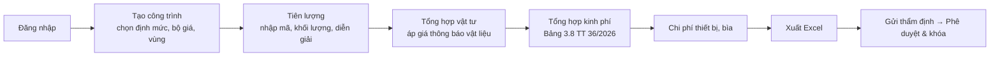

## Mục lục

1. [Đăng nhập và danh sách công trình](#1-đăng-nhập-và-danh-sách-công-trình)
2. [Tạo công trình mới](#2-tạo-công-trình-mới)
3. [Sheet Tiên lượng: nhập công tác](#3-sheet-tiên-lượng-nhập-công-tác)
4. [Tra mã định mức](#4-tra-mã-định-mức)
5. [Diễn giải khối lượng](#5-diễn-giải-khối-lượng)
6. [Menu chuột phải và phím tắt](#6-menu-chuột-phải-và-phím-tắt)
7. [Phân tích và Tổng hợp vật tư, áp giá thông báo](#7-phân-tích-và-tổng-hợp-vật-tư-áp-giá-thông-báo)
8. [Tổng hợp kinh phí và TH chi phí XD](#8-tổng-hợp-kinh-phí-và-th-chi-phí-xd)
9. [Chi phí thiết bị, thông tin công trình, bìa](#9-chi-phí-thiết-bị-thông-tin-công-trình-bìa)
10. [Phiên bản, thẩm định, phê duyệt, xuất Excel](#10-phiên-bản-thẩm-định-phê-duyệt-xuất-excel)
11. [Cập nhật dữ liệu định mức và giá](#11-cập-nhật-dữ-liệu-định-mức-và-giá)
12. [Câu hỏi thường gặp](#12-câu-hỏi-thường-gặp)

---

## 1. Đăng nhập và danh sách công trình

Đăng nhập bằng tài khoản được cấp. Sau khi đăng nhập, màn hình chính có 3 mục ở cột trái:

- **Mở công trình** (`#/`): bấm vào một dòng để mở bảng dự toán.
- **Công trình mới** (`#/moi`).
- **Dữ liệu định mức & giá** (`#/du-lieu`): xem bộ dữ liệu đang có và cập nhật bản mới nhất.

| Đăng nhập | Danh sách công trình |
|---|---|
| 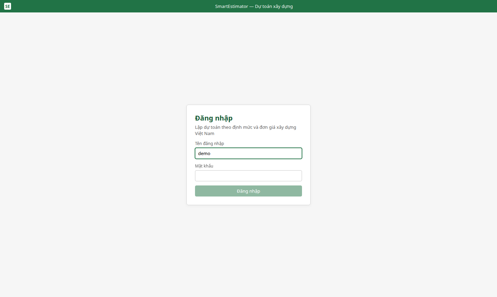 | 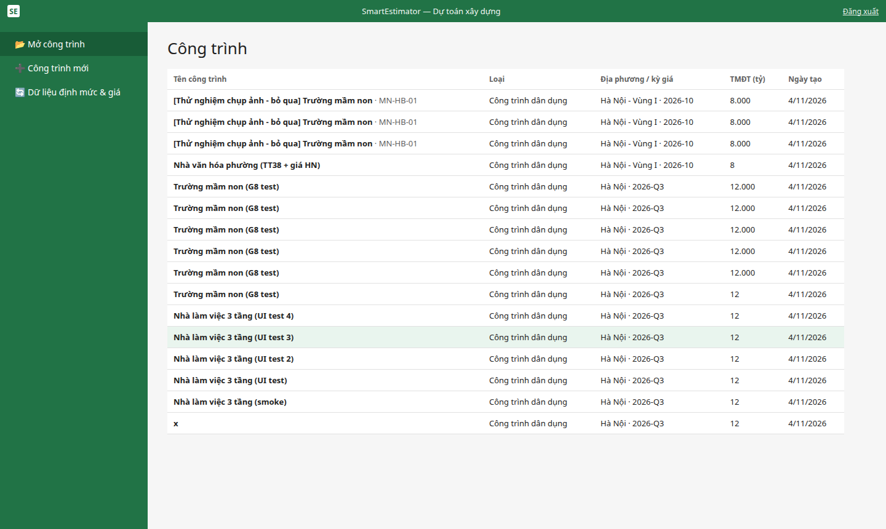 |

## 2. Tạo công trình mới

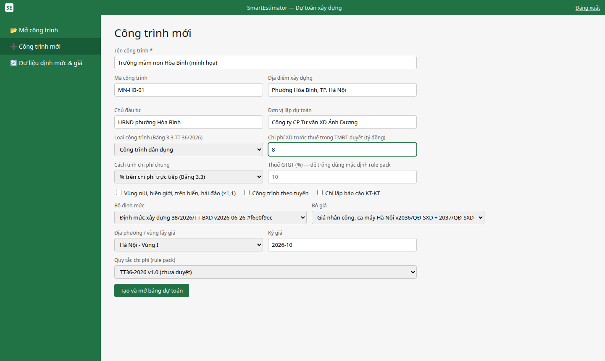

| Trường | Ý nghĩa |
|---|---|
| Tên, mã, địa điểm, chủ đầu tư, đơn vị lập | Hiện trên bìa và trong file Excel |
| Loại công trình | Dùng để chọn tỷ lệ chi phí chung, chi phí công việc không xác định được khối lượng và thu nhập chịu thuế tính trước (Bảng 3.3, 3.5, 3.6 TT 36/2026) |
| Chi phí XD trước thuế trong TMĐT duyệt (tỷ đồng) | Dùng để chọn ngưỡng tỷ lệ. Để trống thì hệ thống lấy theo kết quả tính và hiện cảnh báo |
| Cách tính chi phí chung | % trên chi phí trực tiếp (Bảng 3.3) hoặc % trên chi phí nhân công (Bảng 3.4) |
| Bộ định mức | Mặc định là **Định mức xây dựng 38/2026/TT-BXD** |
| Bộ giá, vùng | Mặc định là **Giá nhân công, ca máy Hà Nội** (QĐ 2036 + 2037), **Vùng I**. Vùng II gồm các xã, phường còn lại |

Bấm **Tạo và mở bảng dự toán**.

## 3. Sheet Tiên lượng: nhập công tác

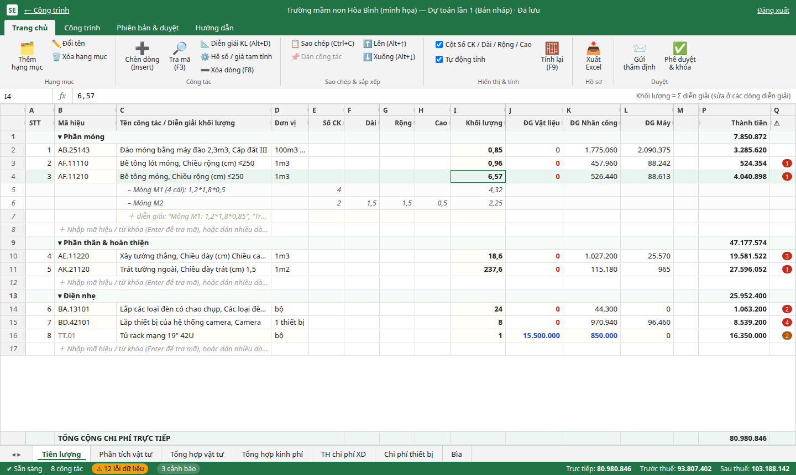

- Mỗi **hạng mục** là một dòng in đậm có tổng phụ. Bấm đúp vào tên để đổi tên; nút **Thêm hạng mục** nằm trên ribbon.
- Dòng **＋** cuối mỗi hạng mục dùng để nhập công tác mới:
  - Gõ **mã đủ** (vd `AF.11210`) rồi Enter để nhận ngay.
  - Gõ **đầu mã** (`AE`) hoặc **từ khóa** (`Bê tông,móng`) rồi Enter để mở hộp **Tra mã** (mục 4).
  - Mã đủ nhưng không có trong định mức (vd `TT.01`) thì thành **mã tạm tính** (chữ cam). Nhập tên, đơn vị và **đơn giá VL / NC / Máy** trực tiếp vào các ô ĐG.
- **Khối lượng**: gõ số (`0,85`) hoặc công thức (`=12*0,8*0,1`), dùng dấu phẩy thập phân kiểu Việt; `x` hoặc `×` cũng được hiểu là phép nhân. Nếu công tác có diễn giải thì khối lượng bằng tổng các dòng diễn giải.
- **Thanh công thức fx** hiện công thức gốc của ô đang chọn và sửa được trực tiếp.
- **Ô vàng nhạt** là ô sửa được. Cột **⚠** hiện số cảnh báo; di chuột vào để xem chi tiết (vd thiếu giá vật liệu).
- Hệ thống tự tính lại sau mỗi thay đổi (tắt được trên ribbon). Bấm **F9** để tính ngay.
- **Dán từ Excel**: copy các cột Mã / Tên / Đơn vị / Khối lượng, chọn dòng "＋" rồi bấm Ctrl+V.

## 4. Tra mã định mức

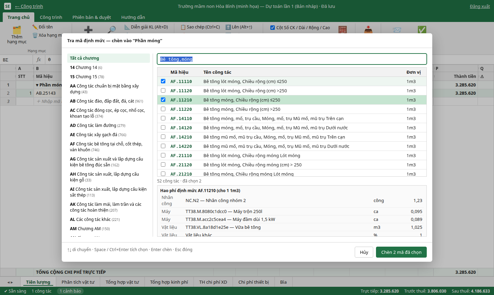

- Ô tìm kiếm nhận đầu mã (`AF.11`) hoặc nhiều từ khóa cách nhau dấu phẩy (`Trát,ngoài`).
- Cột trái lọc theo chương (AB đào đắp, AF bê tông, BA điện, BB mạng / điện nhẹ…).
- Khung dưới hiện **hao phí định mức** của mã đang chọn.
- Tích nhiều mã rồi bấm **Chèn N mã đã chọn**. Phím tắt: ↑↓ để di chuyển, Space để tích, Enter để chèn.
- Phím **F3** mở Tra mã bất kỳ lúc nào. Khi mở từ một dòng công tác, các mã sẽ được chèn lên trên dòng đó.

## 5. Diễn giải khối lượng

Chọn dòng công tác, bấm **Alt+D** (hoặc chuột phải → *Thêm diễn giải khối lượng*), rồi gõ vào dòng "＋ diễn giải":

| Cách nhập | Ví dụ | Kết quả |
|---|---|---|
| Chú thích kèm công thức | `Móng M1 (4 cái): 1,2*1,8*0,5` | 1,08 |
| Chỉ ghi chú (kết thúc bằng `:`) | `Trục A:` | Không cộng vào khối lượng |
| Chỉ công thức | `=2*3,5` | 7 |
| Theo cột kích thước | Số CK 2 · Dài 1,5 · Rộng 1,5 · Cao 0,5 | 2,25 |

Nếu đã nhập Số CK thì giá trị của công thức được nhân với Số CK (ảnh mục 3: Móng M1 có 4 cái nên khối lượng là 4,32). Xóa một dòng diễn giải bằng F8 hoặc chuột phải → *Xóa dòng diễn giải*.

## 6. Menu chuột phải và phím tắt

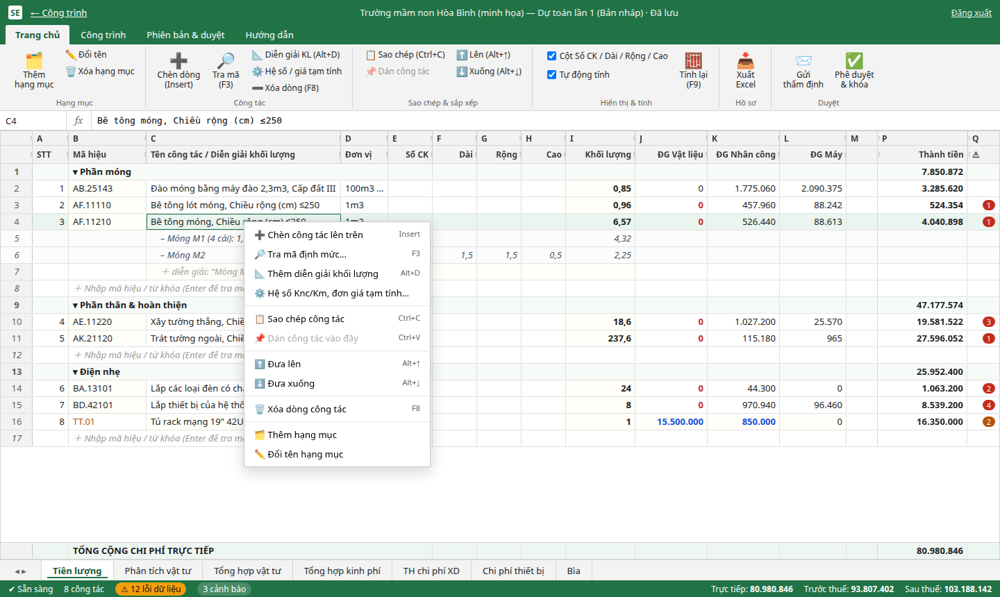

| Phím | Chức năng |
|---|---|
| Insert | Chèn công tác **lên trên** dòng đang chọn |
| F3 | Tra mã định mức |
| F8 (hoặc Ctrl −) | Xóa dòng (xóa được nhiều dòng đã chọn) |
| Alt+↑ / Alt+↓ | Đưa công tác lên / xuống |
| Alt+D | Thêm diễn giải khối lượng |
| Ctrl+C / Ctrl+V | Sao chép / dán công tác, kèm diễn giải và đơn giá tạm tính |
| Ctrl / Shift + click | Chọn nhiều dòng |
| F9 | Tính lại |

Mục **Hệ số Knc/Km, đơn giá tạm tính…** mở hộp thoại để nhập hệ số làm đêm / ngày lễ và đơn giá nhập tay cho từng công tác.

## 7. Phân tích và Tổng hợp vật tư, áp giá thông báo

| Phân tích vật tư | Tổng hợp vật tư |
|---|---|
| 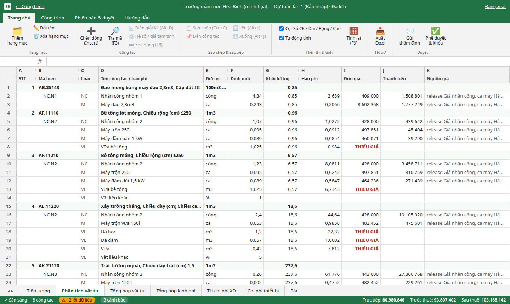 | 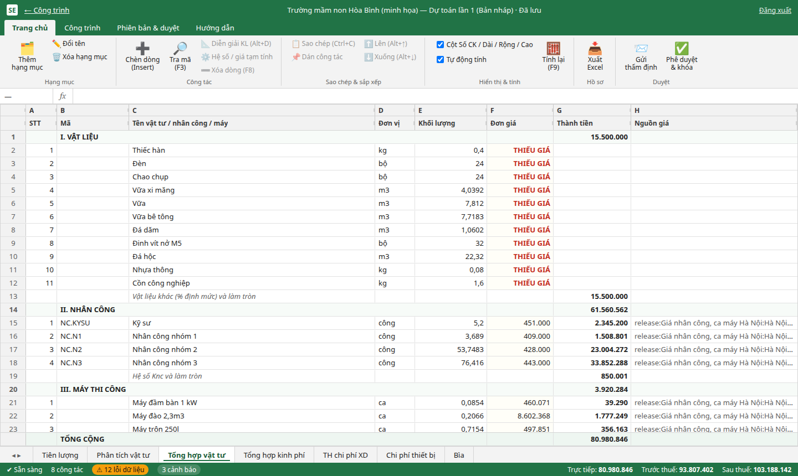 |

- **Phân tích vật tư**: hao phí của từng công tác, bằng khối lượng × định mức, nhân với giá.
- **Tổng hợp vật tư**: gộp toàn công trình theo Vật liệu / Nhân công / Máy. Có dòng đối chiếu "vật liệu khác %, làm tròn" để tổng khớp với sheet Tiên lượng.
- Giá nhân công và ca máy được lấy tự động từ bộ giá Hà Nội của vùng đã chọn.
- **Giá vật liệu** phải chọn theo nhà sản xuất hoặc nơi mua. Dòng nào chưa có giá sẽ hiện **THIẾU GIÁ**. Bấm đúp vào ô **Đơn giá** để mở hộp thoại:

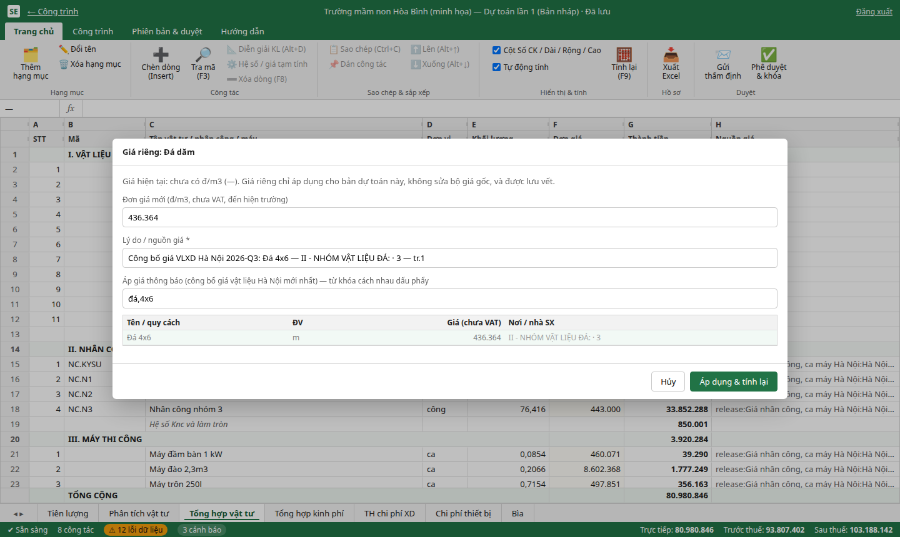

- Ô **Áp giá thông báo** tra trong bảng công bố giá vật liệu Hà Nội mới nhất. Bấm vào một dòng để tự điền đơn giá và lý do (số trang, nhà sản xuất, kỳ công bố).
- Có thể gõ giá theo báo giá nhà cung cấp, nhưng **bắt buộc ghi lý do**.
- Giá riêng chỉ áp cho bản dự toán này, không sửa bộ giá gốc, và được lưu vết.

## 8. Tổng hợp kinh phí và TH chi phí XD

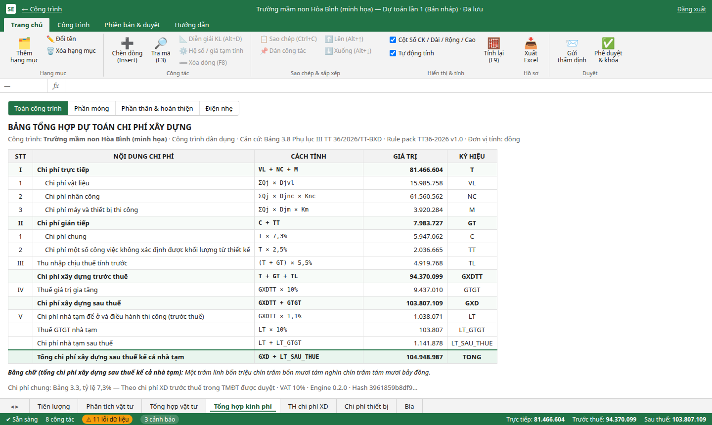

- **Tổng hợp kinh phí** theo Bảng 3.8 TT 36/2026: T → C → TT → GT → TL → GXDTT → GTGT → GXD, cộng chi phí nhà tạm. Có dòng **bằng chữ**. Thanh phía trên chọn xem **toàn công trình** hoặc **từng hạng mục**.
- **TH chi phí XD**: bảng theo từng hạng mục, cộng nhà tạm và chi phí thiết bị, có dòng tổng bằng chữ.

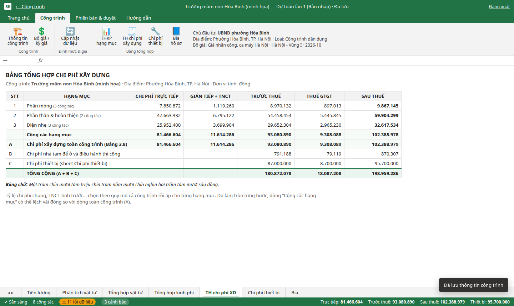

## 9. Chi phí thiết bị, thông tin công trình, bìa

| Chi phí thiết bị | Thông tin công trình |
|---|---|
| 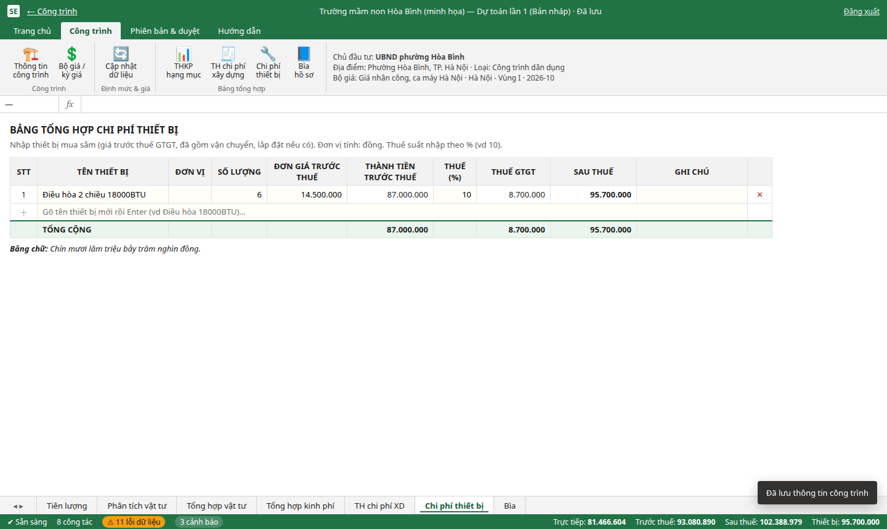 | 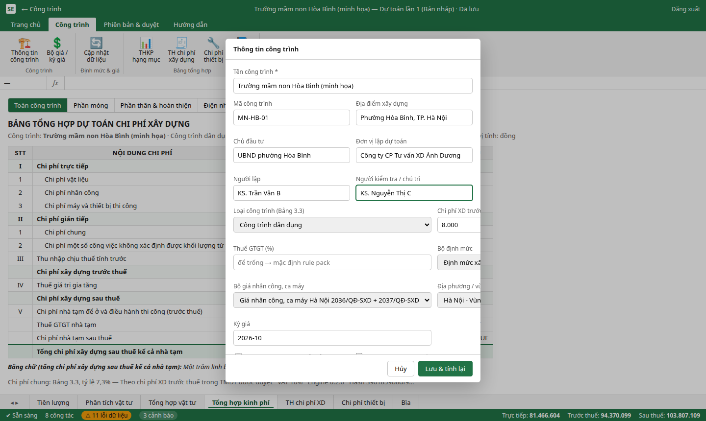 |

- **Chi phí thiết bị**: gõ tên thiết bị rồi Enter, sau đó nhập số lượng, đơn giá trước thuế và thuế suất (%). Thành tiền trước thuế, thuế GTGT và giá sau thuế tự tính.
- Ribbon **Công trình → Thông tin công trình** dùng để sửa chủ đầu tư, đơn vị lập, người lập / kiểm tra, loại công trình, thuế, và **đổi bộ định mức, bộ giá, vùng, kỳ giá**. Lưu xong hệ thống tự tính lại.
- **Bìa**: lấy thông tin công trình và giá trị dự toán (bằng số, bằng chữ). In bằng Ctrl+P.

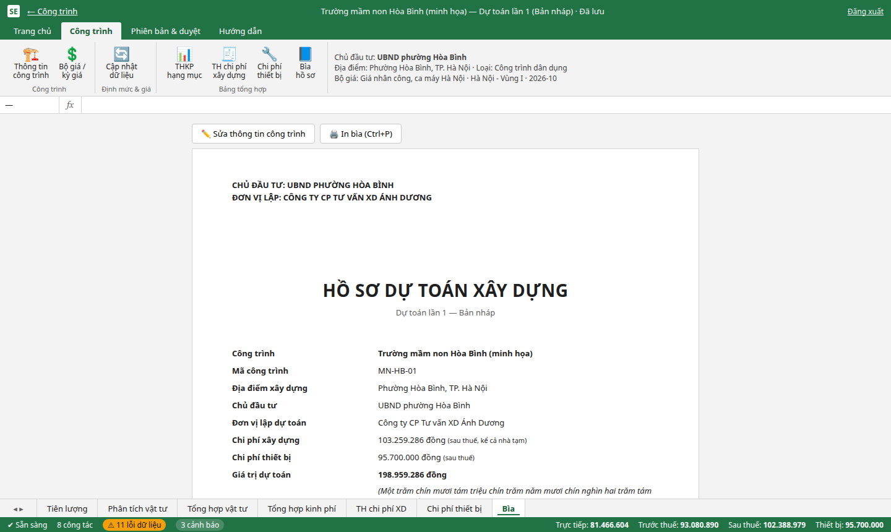

## 10. Phiên bản, thẩm định, phê duyệt, xuất Excel

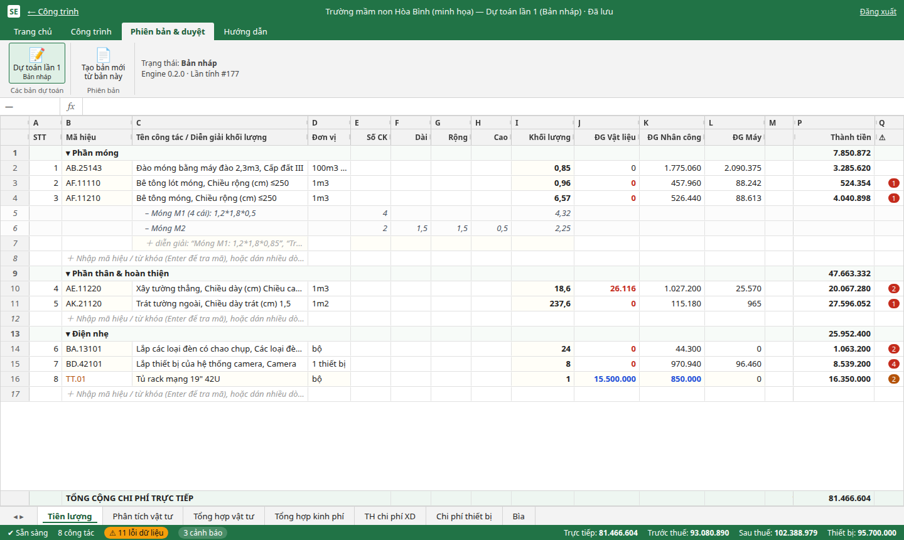

- **Xuất Excel** (ribbon Trang chủ) tạo file 8 sheet: Bìa, Tham số, Tiên lượng (có dòng diễn giải và công thức), Phân tích vật tư, Tổng hợp vật tư, Tổng hợp kinh phí, TH chi phí XD, Chi phí thiết bị. Các ô tính đều là công thức sống để người thẩm định kiểm tra lại.
- **Gửi thẩm định** chuyển bản dự toán sang trạng thái *Đang thẩm định*.
- **Phê duyệt & khóa** lưu snapshot và mã băm. Bản đã khóa không sửa được, và tính lại vẫn ra đúng kết quả cũ dù bộ giá gốc đã đổi. Nếu còn lỗi dữ liệu (thiếu giá, mã sai) thì phải ghi lý do mới duyệt được.
- Ribbon **Phiên bản & duyệt → Tạo bản mới từ bản này** sao chép toàn bộ (hạng mục, công tác, diễn giải, giá riêng, thiết bị) để sửa tiếp.

## 11. Cập nhật dữ liệu định mức và giá

Mở **https://smartestimator.around-ai.com/#/du-lieu**, hoặc ribbon **Công trình → Cập nhật dữ liệu**.

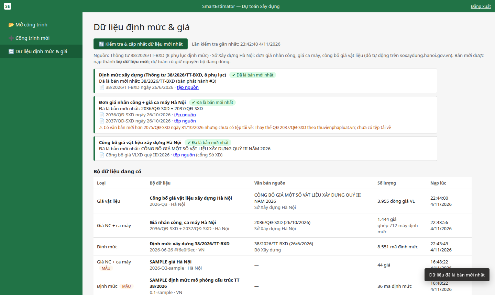

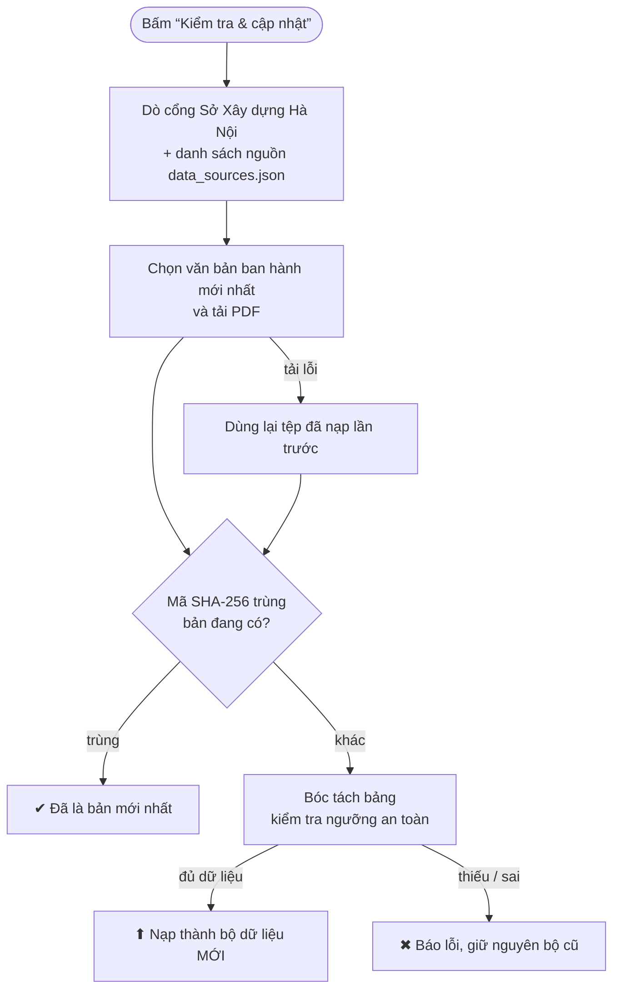

- Chỉ **quản trị viên** được bấm cập nhật.
- Bộ mới được nạp riêng; dự toán cũ vẫn dùng bộ cũ. Muốn dùng bộ mới, vào *Thông tin công trình* để chọn (nên **tạo bản dự toán mới** trước).
- Cảnh báo vàng "Có văn bản mới hơn … chưa có tệp tải về" nghĩa là đã biết có văn bản thay thế nhưng chưa lấy được tệp. Hiện đang có cảnh báo này cho QĐ 2075/QĐ-SXD, văn bản thay QĐ 2037.

## 12. Câu hỏi thường gặp

**Vì sao vật liệu báo THIẾU GIÁ?**
Định mức TT 38 chỉ ghi vật liệu chung (vd "Vữa bê tông", "Đá hộc"), còn bảng công bố giá ghi theo từng nhà sản xuất và địa điểm. Hãy áp giá thông báo hoặc nhập giá báo giá (mục 7). Vữa và bê tông chưa tự tính theo cấp phối Phụ lục VII.

**Một số máy báo thiếu giá?**
Khoảng 12% lượt máy trong định mức chưa ghép được với bảng giá ca máy Hà Nội. Hãy nhập giá riêng (bắt buộc ghi lý do).

**Có sửa được bản đã phê duyệt không?**
Không. Hãy tạo bản mới từ bản đã duyệt (mục 10).

**Hai người cùng sửa một dòng thì sao?**
Người lưu sau sẽ nhận thông báo "Dòng vừa được người khác sửa — đã tải lại" và không ghi đè bản của người kia.

**Vì sao không xóa được công trình?**
Công trình đã có file Excel xuất ra thì được giữ lại để truy vết.
