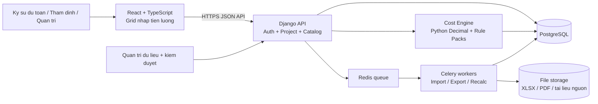

# Đề án webapp dự toán xây dựng tương đương G8 Enterprise

**Phiên bản tài liệu:** 1.0 — 04/11/2026  
**Đích triển khai:** ứng dụng nội bộ của công ty, chạy trên Ubuntu; truy cập bằng trình duyệt.  
**Trạng thái:** kiến trúc và backlog để lập kế hoạch, chưa phải đặc tả pháp quy đã được thẩm định.

## 1. Tóm tắt quyết định

Xây một hệ thống **dự toán theo định mức và đơn giá Việt Nam**, không sao chép phần mềm G8. Giá trị cần tái tạo là chuỗi dữ liệu có thể kiểm tra: **tiên lượng → mã công tác/định mức → hao phí vật liệu, nhân công, máy → giá tại địa điểm và thời điểm → tổng hợp chi phí → hồ sơ dự toán/dự thầu**. Mọi con số trong bản dự toán đã chốt phải tái lập được từ đúng phiên bản dữ liệu và quy tắc tính ban đầu.

Kiến trúc khuyến nghị: **modular monolith** Django/Python + PostgreSQL, frontend React/TypeScript, worker Celery cho nhập/xuất dữ liệu. Triển khai Docker Compose trên một máy Ubuntu trước; chỉ tách dịch vụ khi có tải và tổ chức vận hành chứng minh cần thiết. Không dùng microservices ở giai đoạn đầu.

**Ranh giới sản phẩm:** G8 Enterprise được nhà phát hành mô tả là bản không giới hạn công tác/hạng mục, phục vụ **dự toán và dự thầu**; bản **Settlement** là sản phẩm có thêm chức năng thanh quyết toán. Vì vậy thanh/quyết toán là giai đoạn mở rộng, không phải điều kiện nghiệm thu bản tương đương Enterprise. [Nguồn G8 Enterprise](https://phanmemg8.vn/du-toan-g8-enterprise/) · [So sánh các bản G8](https://phanmemg8.vn/mua-du-toan-g8-moi/).

## 2. Căn cứ khảo sát và mức độ chắc chắn

### 2.1. Quan sát trên gói phần mềm

- Bộ cài `CaiDatG8.msi` lấy từ trang tải của Hoàng Hà, SHA-256: `40f48fb9509ecc24e0022bb97ad25d617dce0b73f23ed633a8484646257d941b`; giải nén tĩnh thấy 258 tệp. Không cài đặt hoặc thực thi G8.
- Chương trình chính `G8Ver2020.exe` là PE/.NET x86, assembly `G8` v10.0.0.0. REA Evidence: `ev_63bf1a0b283612be5b559b6582665e990c35a1fc29d724abe72d9277a06eb81a`.
- Tham chiếu `FarPoint.Win.Spread`, `FarPoint.Excel`, `Microsoft.Office.Interop.Excel`, cùng nhiều thư viện nghiệp vụ. REA Evidence: `ev_f41890fd6a71b793c948e14cbb837c853b4e46cefc7710a160053e2e07d3369c`.
- Gói chứa nhiều cơ sở dữ liệu Access theo các vai trò đặt tên `DinhMuc`, `DonGia`, `GiaVL`, `GiaNC`, `GiaM`, `CuocVC`, `HeSoCPXL`, `Tinh`, v.v. Đây là **quan sát tên tệp**, không khẳng định đã giải mã bảng, quan hệ hay toàn bộ thuật toán của chúng.
- Chương trình chính có dấu hiệu làm rối tên lớp (`DotfuscatorAttribute`); REA không quan sát chạy thật và phần đọc thành viên bị giới hạn dung lượng. Vì vậy sơ đồ G8 bên dưới là **mô hình nghiệp vụ suy ra** từ gói cài và tài liệu, không phải sơ đồ mã nguồn xác thực. REA Evidence: `ev_23cc258fb335c8a02b0284013eaa9137b7362e0209dccf4768a239dfc2e8e0e4`.

### 2.2. Tính năng được nhà phát hành công bố

G8 Enterprise có dự toán, dự thầu, xuất Excel có công thức, nhập Excel để thẩm định, thẩm định khối lượng/đơn giá, cước vận chuyển, thống kê vật liệu/thép, biểu đồ tiến độ và chuyển đổi phụ lục vữa. Mức sâu/độ chính xác của từng tính năng cần xác nhận bằng bộ hồ sơ mẫu khi triển khai. [Trang sản phẩm Enterprise](https://phanmemg8.vn/du-toan-g8-enterprise/) và [hướng dẫn thao tác](https://phanmemg8.vn/huong-dan-su-dung-du-toan-g8/).

### 2.3. Phần chưa xác minh

Chưa có kiểm thử runtime trên Windows, chưa đọc toàn bộ cấu trúc `.mdb`/`.hce`, chưa xác minh các trường hợp pháp quy, xử lý làm tròn, giới hạn hiệu năng và định dạng Excel tương thích. Không dùng bản thiết kế này để tuyên bố “tính y hệt G8” trước khi chạy đối chiếu kết quả thực tế.

## 3. Phạm vi chức năng và thứ tự ưu tiên

| Nhóm | Mức | Yêu cầu đầu ra |
|---|---|---|
| Công trình, hạng mục, công tác không giới hạn bởi giấy phép | P0 | CRUD, sao chép dự án/hạng mục, tìm mã, công thức khối lượng |
| Định mức và hao phí VL/NC/máy | P0 | Phân tích theo mã, định mức tự xây dựng, thay thế nguồn lực |
| Đơn giá, giá hiện trường và hệ số | P0 | Theo địa phương, kỳ giá, nguồn; cho phép giá nhập tay có lý do |
| Tính dự toán và bảng tổng hợp | P0 | Tiên lượng, phân tích vật tư, tổng hợp vật tư, tổng hợp kinh phí |
| Excel/PDF và hồ sơ dự thầu | P0 | Xuất bảng có công thức/giải trình; mẫu có phiên bản |
| Nhập Excel và thẩm định | P1 | Mapping cột, kiểm tra mã/khối lượng/giá, báo cáo sai lệch |
| Cước vận chuyển, thống kê thép/vữa | P1 | Module riêng, cấu hình quy tắc và kiểm thử đối chiếu |
| Quản trị dữ liệu, audit, duyệt phiên bản | P0 | Truy vết nguồn mọi số liệu, khóa snapshot khi phát hành |
| Tiến độ thi công/biểu đồ, song ngữ | P2 | Làm sau khi lõi tính và hồ sơ ổn định |
| Thanh quyết toán | Ngoài phạm vi Enterprise | Dự án riêng sau khi bản Enterprise được nghiệm thu |

`P0` là bản sử dụng nội bộ khả thi; `P1` hoàn thiện mức gần Enterprise; `P2` là tiện ích mở rộng. Không gọi P0 là “đầy đủ tương đương Enterprise”.

## 4. Kiến trúc mục tiêu



### 4.1. Vì sao chọn stack này

- **Backend:** Django 5.2 LTS + Django REST Framework; hệ sinh thái Python thuận tiện cho xử lý Excel, PDF, dữ liệu bảng và công thức. Pin phiên bản theo lockfile, rà soát hỗ trợ khi bắt đầu dự án. Django hỗ trợ PostgreSQL chính thức. [Django databases](https://docs.djangoproject.com/en/5.2/ref/databases/).
- **Database:** PostgreSQL, các trường tiền/hệ số là `NUMERIC`, không dùng `float`; `JSONB` chỉ cho cấu hình/kết quả phụ, không thay thế các bảng quan hệ cốt lõi.
- **Frontend:** React + TypeScript + AG Grid **Community** cho lưới khối lượng và giá; các phép tính pháp quy thực hiện ở server. Chỉ dùng module Community vì sản phẩm công ty không mặc nhiên được dùng AG Grid Enterprise miễn phí. [AG Grid cài đặt/giấy phép](https://www.ag-grid.com/javascript-data-grid/installation/). Không chọn Handsontable mặc định vì production thương mại cần giấy phép riêng. [Giấy phép Handsontable](https://handsontable.com/docs/javascript-data-grid/software-license/).
- **Tác vụ nền:** Celery + Redis cho import hàng nghìn dòng, xuất Excel/PDF, tính lại toàn công trình; API trả job ID và trạng thái. [Celery](https://docs.celeryq.dev/en/stable/getting-started/introduction.html).
- **File:** lưu trên filesystem được backup hoặc object storage S3-compatible nội bộ; DB lưu metadata, hash và quyền truy cập.
- **Triển khai:** Docker Compose, Nginx/Caddy trước Django, TLS, PostgreSQL/Redis chỉ trong mạng riêng, backup định kỳ, giám sát lỗi và log. `runserver` không dùng cho production. [Django deployment](https://docs.djangoproject.com/en/5.2/howto/deployment/).

### 4.2. Biên giới module backend

1. `identity`: người dùng, vai trò, nhóm/phòng ban, quyền theo dự án.
2. `catalog`: công tác, nguồn lực, định mức, định mức thay thế; không cập nhật trực tiếp bản đã xuất bản.
3. `pricebook`: giá VL/NC/máy, vùng/kỳ, cước, giá do công ty khảo sát, báo giá nhà cung cấp.
4. `regulations`: gói quy tắc, phiên bản hiệu lực, tham số, căn cứ và bộ test.
5. `projects`: công trình, hạng mục, dòng tiên lượng, công thức khối lượng.
6. `calculation`: dịch vụ tính thuần, deterministic; nhận snapshot đầu vào, trả bảng kết quả và cây giải trình.
7. `reports`: template Excel/PDF, hồ sơ dự toán/dự thầu.
8. `review`: thẩm định, sai lệch, bình luận, duyệt/phát hành.
9. `ingestion`: import và kiểm duyệt dữ liệu nguồn.
10. `audit`: nhật ký bất biến ở mức ứng dụng, versioning và diff.

Các module cùng một codebase và DB nhưng chỉ giao tiếp qua interface/dịch vụ rõ ràng. Không cho frontend tự tính số tiền cuối cùng rồi lưu ngược vào DB.

## 5. Mô hình dữ liệu tối thiểu

| Bảng/aggregate | Trường cốt lõi |
|---|---|
| `source_document` | cơ quan ban hành, số văn bản, URL/tệp, SHA-256, ngày ban hành/hiệu lực, tình trạng đính chính |
| `dataset_release` | loại dữ liệu, địa phương/ngành, phiên bản, nguồn, ngày hiệu lực, trạng thái draft/reviewed/published |
| `work_item` | mã, tên, đơn vị, nhóm công tác, bộ định mức, hiệu lực |
| `resource` | mã, loại `MATERIAL/LABOR/MACHINE`, tên, đơn vị, quy cách |
| `norm_component` | work_item, resource, hao phí trên 1 đơn vị công tác, điều kiện áp dụng |
| `price_observation` | resource, vùng, kỳ, giá, đơn vị, nguồn, mức tin cậy, trạng thái duyệt |
| `cost_rule_pack` | phiên bản, căn cứ, phạm vi công trình, biểu thức/tham số đã kiểm duyệt |
| `project`, `project_item` | dự án, địa điểm, loại công trình, hạng mục, thứ tự, mã công tác, diễn giải |
| `quantity_expression` | công thức, biến số, đơn vị, kết quả, người sửa, lịch sử |
| `estimate_revision` | trạng thái draft/review/approved/issued, snapshot ID, content hash |
| `calculation_run`, `calculation_line` | input hash, engine version, kết quả từng bước, làm tròn, warning |
| `report_artifact`, `audit_event` | file/hồ sơ, hash, template version, người tạo; thay đổi và lý do |

Khóa ngoại định mức/giá gắn **release ID**, không chỉ gắn mã công tác. Giá nhập tay và định mức tự lập lưu thành override riêng, không ghi đè dữ liệu gốc. Tất cả thời gian hiệu lực và kỳ giá tính theo múi giờ/ngày áp dụng được chỉ rõ; lưu tiền VND và đơn vị đo ở dạng chuẩn hóa.

## 6. Quy tắc tính và tính tái lập

Với công tác `i`, khối lượng `Qᵢ` và nguồn lực `r`, lõi tính biểu diễn:

```text
HaoPhi[i,r] = Q[i] × DinhMuc[i,r] × HeSoDieuChinh[i,r]
ChiPhiNguonLuc[i,r] = HaoPhi[i,r] × GiaDenHienTruong[r]
TrucTiep[i] = Σ ChiPhiNguonLuc[i,r] + ChiPhiTrucTiepKhac[i]
TongHop = apply(rule_pack, Σ TrucTiep, thong_tin_cong_trinh)
```

Đây là **khung thiết kế**, không phải công thức pháp quy hoàn chỉnh. Chi phí chung, thu nhập chịu thuế tính trước, nhà tạm, VAT, quản lý dự án, tư vấn… phải được mô hình hóa thành từng quy tắc có căn cứ và thứ tự áp dụng đúng theo loại hồ sơ. Không hard-code tỷ lệ trong React hoặc template Excel.

Yêu cầu kỹ thuật cho engine:

- Dùng `Decimal`/`NUMERIC`; quy định rõ số chữ số và chế độ làm tròn **tại từng bước**, được kỹ sư dự toán phê duyệt.
- Hàm tính thuần: cùng input snapshot + engine version + rule pack phải ra cùng output hash; không phụ thuộc “giá mới nhất” lúc mở lại dự án.
- Kết quả là đồ thị giải trình: mỗi thành tiền truy được `Q`, mã/định mức, giá, hệ số, cước, nguồn và bước làm tròn.
- Kiểm tra đơn vị tính, số âm, mã không tồn tại, thiếu giá, bộ định mức trái thời điểm/địa phương, nguồn giá chưa duyệt. Warning không tự biến thành giá 0.
- Thay đổi giá/khối lượng chỉ tính lại các dòng bị ảnh hưởng; toàn dự án có thể tính lại trong background để kiểm chứng.

## 7. Nguồn dữ liệu Việt Nam và quản trị thay đổi

Từ 01/07/2026, Bộ Xây dựng công bố [TT 36/2026/TT-BXD về phương pháp quản lý chi phí](https://moc.gov.vn/pl/Pages/ChiTietVanBan.aspx?vID=741), [TT 37/2026/TT-BXD về phương pháp xác định định mức](https://moc.gov.vn/pl/Pages/ChiTietVanBan.aspx?TypeVB=1&vID=740) và [TT 38/2026/TT-BXD về định mức xây dựng](https://moc.gov.vn/pl/Pages/ChiTietVanBan.aspx?TypeVB=1&vID=742). TT 36 có [quyết định đính chính](https://moc.gov.vn/vn/tin-tuc/1176/96587/dinh-chinh-thong-tu-so-362026tt-bxd-ngay-26062026-cua-bo-xay-dung-ve-huong-dan-mot-so-noi-dungphuong-phap-xac-dinh-va-quan-ly-chi-phi-dau-tu-xay-dung.aspx). Phải lưu cả văn bản, sửa đổi/đính chính, hiệu lực và quy định chuyển tiếp theo từng hồ sơ; không tự nhận “tuân thủ pháp luật” chỉ vì nhập số thông tư vào UI.

**Pipeline dữ liệu:** lấy nguồn chính thức của Bộ/Sở Xây dựng, công bố giá địa phương, báo giá được phép dùng và dữ liệu nội bộ → lưu tệp nguyên gốc + hash → OCR/parser có kiểm tra → chuẩn hóa mã/đơn vị → đối soát hai người → chạy validation → phát hành `dataset_release` → tạo diff cho người dùng. Tài liệu không có quyền tái sử dụng rõ ràng thì không nạp tự động hàng loạt vào sản phẩm. Không lấy cơ sở dữ liệu từ G8 làm nguồn production nếu chưa có quyền phù hợp.

Preflight nguồn mở: [OpenConstructionEstimate/DDC-CWICR](https://github.com/datadrivenconstruction/OpenConstructionEstimate-DDC-CWICR) có nhánh dữ liệu Việt Nam và mô hình hao phí × giá để tham khảo; **không** xem nó là bộ định mức/giá hiện hành đã được công ty thẩm định. Hiện chưa thấy một dự án OSS đủ căn cứ để thay trực tiếp toàn bộ nghiệp vụ G8 Enterprise Việt Nam; vì vậy đề xuất dùng thư viện/framework sẵn có nhưng tự xây lõi nghiệp vụ và pipeline dữ liệu.

## 8. API và giao diện

API dự kiến (prefix `/api/v1`):

```text
GET    /catalog/work-items?query=&release=&region=
GET    /catalog/work-items/{id}/norms
GET    /prices?resource=&region=&period=
POST   /projects
GET    /projects/{id}/revisions
POST   /projects/{id}/revisions
PATCH  /revisions/{id}/lines/{line_id}
POST   /revisions/{id}/calculate
GET    /calculation-runs/{id}
GET    /calculation-runs/{id}/explain?line_id=
POST   /revisions/{id}/import-excel
POST   /revisions/{id}/review
POST   /revisions/{id}/approve
POST   /revisions/{id}/export?template=estimate-xlsx
```

Giao diện chính: danh sách công trình; màn hình công trình/hạng mục; grid tiên lượng với copy/paste từ Excel, autocomplete mã và diễn giải khối lượng; panel phân tích vật tư/giá; tổng hợp chi phí; màn hình đối chiếu phiên bản; nhập Excel có preview/mapping; quản trị dataset; review/approve. Dùng optimistic concurrency (`revision`/`ETag`) để hai người không vô tình ghi đè. Với hàng nghìn dòng, virtualized grid và phân trang/lazy-load; không tải toàn bộ dữ liệu định mức vào trình duyệt.

## 9. Bảo mật và vận hành Ubuntu

- SSO/OIDC nếu công ty có IdP; nếu chưa có thì tài khoản nội bộ, MFA cho quản trị, RBAC theo dự án và hành động. Audit cả giá nhập tay, định mức tự lập, phê duyệt, tải hồ sơ.
- Chỉ công bố reverse proxy HTTPS; PostgreSQL/Redis không mở Internet. Secret nằm trong secret store/file quyền hạn chặt, không commit vào repo.
- Import Excel giới hạn dung lượng, kiểm tra định dạng, chống zip bomb; bỏ macro; escape cell khi xuất CSV/XLSX để tránh formula injection từ tên công tác/ghi chú.
- Backup DB và file hàng ngày, mã hóa, kiểm tra restore định kỳ; lưu ít nhất một bản ngoài máy chủ. Gắn version cho migration và report template.
- Log JSON + metrics cho thời gian tính, job fail, số dòng thiếu giá, lần phát hành dataset, dung lượng backup; cảnh báo khi job/import lỗi.
- Môi trường `dev`, `staging`, `prod` tách dữ liệu. Release theo CI/CD, migration có backup/rollback; không thử dữ liệu pháp quy mới trực tiếp ở production.

## 10. Backlog triển khai theo cổng nghiệm thu

### Gate 0 — discovery và hồ sơ chuẩn (2–3 tuần)

- [ ] Chọn **một** loại công trình và **1–2** địa phương để làm pilot; thống nhất biểu mẫu dự toán/dự thầu công ty thực dùng.
- [ ] Thu 5–10 hồ sơ thật đã được kiểm tra (có cả trường hợp cước, mã tạm tính, đổi giá, nhiều hạng mục), ẩn dữ liệu nhạy cảm.
- [ ] Kỹ sư dự toán lập bộ đáp án từng bảng, quy tắc làm tròn, cơ sở pháp quy và chấp nhận chênh lệch.
- [ ] Rà nguồn dữ liệu, điều kiện sử dụng, người chịu trách nhiệm cập nhật và duyệt.
- **Thoát gate:** PRD, bộ hồ sơ chuẩn, data dictionary, danh sách rule pack và mẫu báo cáo được trưởng bộ phận dự toán ký duyệt.

### Gate 1 — nền tảng và dữ liệu (3–4 tuần)

- [ ] Tạo repo, CI, compose dev/staging, migration, backup/restore, RBAC, audit.
- [ ] Xây schema catalog/pricebook/regulations/projects; chuẩn hóa mã, đơn vị và vùng.
- [ ] Viết importer nguồn chính thức cho phạm vi pilot, lưu bản gốc/hash, workflow review/publish.
- [ ] Kiểm thử dữ liệu: trùng mã, thiếu đơn vị, hao phí âm, không khớp thời điểm, thiếu source.
- **Thoát gate:** phát hành được dataset pilot có thể truy ngược từng bản ghi đến nguồn.

### Gate 2 — lõi tính và hồ sơ MVP (4–6 tuần)

- [ ] Grid tiên lượng, công thức khối lượng an toàn, tìm mã, nhiều hạng mục.
- [ ] Engine VL/NC/máy, giá hiện trường/override, rule pack, bảng tổng hợp và cây giải trình.
- [ ] Snapshot revision, khóa bản phát hành; Excel/PDF các bảng P0.
- [ ] Golden tests theo hồ sơ Gate 0, property tests cho tính lại/đơn vị/làm tròn, kiểm thử tải 10.000 dòng.
- **Thoát gate:** toàn bộ hồ sơ pilot cho ra kết quả đúng ngưỡng đã ký duyệt; mở lại bản phát hành không đổi số; mọi dòng thiếu giá có cảnh báo.

### Gate 3 — gần Enterprise (4–6 tuần)

- [ ] Import Excel có preview/mapping và báo lỗi theo dòng; thẩm định khối lượng/đơn giá so với revision chuẩn.
- [ ] Cước vận chuyển, thống kê vật tư/thép, chuyển đổi vữa, dự thầu/chiết tính theo nhu cầu thật.
- [ ] Review/approve, so sánh 2 revision, biểu mẫu công ty, cải thiện UX và hiệu năng.
- **Thoát gate:** đội dự toán làm được hồ sơ thực từ đầu đến cuối trên webapp, xuất hồ sơ được chấp nhận nội bộ và có báo cáo sai lệch khi thẩm định.

### Gate 4 — pilot và go-live (2–3 tuần)

- [ ] Chạy song song webapp và quy trình hiện tại trên tối thiểu 3 hồ sơ mới.
- [ ] Kiểm thử phân quyền, khôi phục backup, chuyển giao vận hành và đào tạo.
- [ ] Chốt quy trình cập nhật giá/định mức và SLA xử lý lỗi dữ liệu.
- **Thoát gate:** người phụ trách dự toán và IT ký biên bản nghiệm thu; mới cho dùng làm nguồn hồ sơ chính.

Ước lượng **15–22 tuần** với 2 backend, 1 frontend, 1 QA/data engineer bán thời gian và 1 kỹ sư dự toán làm chủ nghiệp vụ; đây là phạm vi pilot, không phải cam kết thời gian cho toàn bộ ngành/địa phương. Khối lượng làm sạch dữ liệu có thể chi phối tiến độ hơn công việc code.

## 11. Tiêu chí nghiệm thu định lượng

1. **Đúng số:** 100% hồ sơ vàng pass theo ngưỡng từng bảng do kỹ sư duyệt; sai khác phải có giải trình (làm tròn/nguồn giá/quy tắc), không chỉ so tổng cuối.
2. **Tái lập:** cùng snapshot + engine version cho output hash giống nhau; thay dataset mới không đổi revision đã phát hành.
3. **Truy vết:** từ một thành tiền mở được đến công thức khối lượng, định mức, giá, hệ số, nguồn văn bản và người override.
4. **An toàn dữ liệu:** import lỗi không làm hỏng revision; hai người sửa đồng thời không ghi đè im lặng; restore từ backup staging thành công.
5. **Hiệu năng pilot:** thao tác grid thường < 300 ms ở phía trình duyệt trên máy mẫu; tính 10.000 dòng < 60 giây trên cấu hình staging đã chốt. Đây là *mục tiêu thử nghiệm*, phải đo và điều chỉnh trước nghiệm thu.
6. **Hồ sơ:** Excel/PDF đủ mẫu P0, công thức và số tổng hợp đối chiếu được; nhập lại file Excel chuẩn không mất mã, khối lượng và giá.

## 12. Rủi ro và quyết định cần công ty chốt

- **Nguồn dữ liệu/giấy phép:** dữ liệu của G8 không mặc nhiên được dùng lại. Cần xác nhận nguồn chính thức, quyền khai thác, phạm vi tỉnh/ngành và người chịu trách nhiệm cập nhật.
- **Quy tắc pháp quy:** phải có chuyên gia dự toán xác nhận từng gói quy tắc, đặc biệt văn bản đính chính và điều khoản chuyển tiếp.
- **Tương thích Excel:** file doanh nghiệp rất không đồng nhất; cần chốt 2–3 template đầu vào chuẩn trước khi hứa “nhập mọi Excel”.
- **Phạm vi Enterprise:** định nghĩa rõ doanh nghiệp có cần thẩm định, cước, thép, song ngữ, tiến độ trong đợt đầu hay không; Settlement là phạm vi khác.
- **Triển khai:** nội bộ qua VPN hay công khai Internet, số người dùng đồng thời, dung lượng hồ sơ, yêu cầu SSO/backup và thời gian khôi phục.

**Bước khởi động:** lấy 5–10 hồ sơ mẫu đã được công ty duyệt và chọn 1 loại công trình/1–2 địa phương. Từ đó chuyển tài liệu này thành PRD và bộ acceptance tests trước khi viết engine.

## 13. Nguồn tham khảo chính

1. [G8 Enterprise — công bố tính năng](https://phanmemg8.vn/du-toan-g8-enterprise/).
2. [G8 — hướng dẫn sử dụng](https://phanmemg8.vn/huong-dan-su-dung-du-toan-g8/).
3. [Giáo trình thực hành G8](https://qnu.edu.vn/Resources/Docs/SubDomain/fea/gochoctap/HuongDanChiTietG8.pdf) (tài liệu cũ, chỉ dùng để hiểu luồng thao tác/bảng).
4. [Bộ Xây dựng — TT 36/2026](https://moc.gov.vn/pl/Pages/ChiTietVanBan.aspx?vID=741), [TT 37/2026](https://moc.gov.vn/pl/Pages/ChiTietVanBan.aspx?TypeVB=1&vID=740), [TT 38/2026](https://moc.gov.vn/pl/Pages/ChiTietVanBan.aspx?TypeVB=1&vID=742).
5. [Django deployment](https://docs.djangoproject.com/en/5.2/howto/deployment/), [Celery documentation](https://docs.celeryq.dev/en/stable/), [AG Grid Community](https://www.ag-grid.com/javascript-data-grid/installation/).
